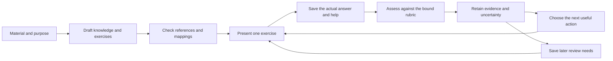

# First usable version of the memorization system

Status: finalized implementation plan for [Design Baseline 1](design-baseline.md), 2026-10-16. The user requested design finalization. This specifies the build and its acceptance work; it does not authorize starting implementation, configuring a model or deploying the app.

## The result to build

The [integrated lifecycle contract](learning-lifecycle-contract.md) and [tracking contract](../learning-observability/tracking-contract.md) patch the seven cross-contract findings. They define admission, checked teaching/variant generation, ownership and ordering of real attempts, recovery from uncertain exposure, prospective plan creation and qualified counts. The [closure traces](cross-contract-closure.md) map every audit case to those rules. This completes that design patch; runtime, semantic quality and learning-effect qualification remain separate.

The [everyday-learning design](everyday-learning-design.md) now supplies the detailed first-release policy proposals for evidence age/weak-unit flags, fresh and comparable exercises, session priorities/backlog, repeated repair, and dashboard-to-practice navigation. Its [43 acceptance cases](everyday-learning-cases.md#8-acceptance-cases-to-carry-into-implementation) extend the pack below. Their defaults are adopted for baseline planning; the two focused research reviews do not establish optimal limits or learning benefit.

A learner brings a short piece of material, says what they want to remember or do, and receives a useful learning outline and exercise. The system interprets their actual answer, identifies a supported gap or asks a useful clarifying question, supplies focused help, and checks the repaired knowledge in a fresh task. Closing and reopening the application preserves the source, answers, corrections and next review.

The first version must work for **a simple fact and a connected explanation through the same code path**. It must also represent a text-described procedure and distinguish knowing the steps from actually executing them. Kubernetes remains optional example material. The system's central objects are knowledge and evidence about its use; a card is only one exercise form.

**Selected interface: a web-based application.** The learner uses the browser for material intake, outline editing, practice, feedback, progress and corrections. The reference build is a local application for one learner with saved local progress. A hosted/multi-user deployment is outside this baseline and needs an explicit amendment. This interface decision preserves the accepted learning sequence and does not authorize implementation. A local application may use a remote model; local storage must not be described as fully offline operation.

**Done means:** a new, previously unauthored text can complete this real loop; the learner can return later and correct a content or grading mistake; the same behavior passes the cross-subject acceptance cases below. Passing those checks establishes a usable pilot, not superior learning or safe omission of future reviews.

## The learner experience

Keep three places in the web interface:

1. **Material and learning outline.** Paste or upload plain text, add a title, and state the purpose. Show the proposed ideas, their important connections and conditions, plus a sample exercise. Let the learner edit or begin. Surface specific doubts; do not require approval of every node, rubric or model judgment.
2. **Practice.** Show one question and accept the learner's own words. Offer help, record when it was used, and explain feedback plainly. Make the next request explicit: answer a question, inspect an explanation, or try a fresh task. The learner must never wonder whether they are a learner or a reviewer.
3. **Progress and corrections.** Use Learning and Time and results views to show independent demonstrations, later checks, maintained capabilities, uncertain/helped work and due needs, alongside the full effort spent. Every conclusion links to its evidence. From an answer or source, allow “this judgment is wrong” or “this material is wrong,” with a reason. These actions revise different records.

For familiar material, begin with a meaningful larger exercise. For unfamiliar material, permit reading an explanation first. Do not impose a universal understanding → memorization → application sequence. A correct answer reconstructed slowly is not a fluency result unless fluent retrieval was the stated target and timing was measured appropriately.

## Preserve the full design in a small release

| Include in the first usable version | Concrete behavior |
|---|---|
| Meaningful units and connected structures | Keep claims, scope, source passages, typed relations and an explanation of how a group fits together; avoid one-card-per-sentence conversion |
| Goal-specific capabilities | Distinguish recall, explanation, selecting an applicable idea and describing a procedure; add timing or execution only when the task can actually observe it |
| Assisted authoring | A real model call proposes knowledge and exercises from new text; retain provenance, inspect errors and allow editing |
| New material connected to existing material | Search existing claims, present possible reuse or contrast, and preserve sources; make an explicit reviewed mapping rather than merging from similarity alone |
| Larger exercises and narrow diagnosis | Judge the actual response against explicit criteria; distinguish a missing component, missing relationship, omitted evidence, misread and ambiguous interpretation |
| Useful corrective teaching | Deliver a concrete explanation or worked step for the supported gap, record the help, then ask a fresh integrated question |
| Flexible practice size and overlapping coverage | One suitable exercise can serve several pending targets; reselect after the actual answer and retain the underlying component detail |
| Qualitative inference | Record a scoped hypothesis about unshown knowledge, alternatives and supporting evidence; use it to choose a useful question without inventing an observed pass |
| Durable history and correction | Save original answers, context, assistance and assessment versions; preserve source/content changes and update only justified conclusions |
| Progress survives architecture changes | Keep curriculum and target identities, historical evidence, pending work and schedules across releases; verify migration and export/restore before accepting an upgrade |
| Real later sessions | Record actual timestamps and due dates; distinguish an immediate post-help check from later independent retrieval |
| Honest cost and stopping | Include answering, setup, feedback and diagnosis; stop with remaining needs visible when the session budget is exhausted |
| Progress and efficiency observability | Show meaningful capability milestones and maintenance; compare scoped outcomes with complete effort, expose missing evidence/timing, and surface specific opportunities to improve the method |

Defer multi-user accounts, synchronization, public deployment, PDF/diagram/speech ingestion, live operational environments, automatic general merges/splits, a graph visualization editor, and a curriculum marketplace. These are first-release limits, not a redefinition of general memorization learning. A procedure requiring real execution remains unverified until a suitable execution environment exists.

Also defer numerical mastery displays, fitted graph propagation, learned transfer coefficients, bandits and omission of future reviews based only on inference. Preserve them as evaluation candidates. Explicitly covering several targets in one answer is already useful compression; untested-knowledge forecasts and claims of durable reinforcement need additional evidence.

## What exists and what still needs building

The [repository overview](../../README.md) and source audit show behavior experiments, not an application. Treat their contracts and counterexamples as reuse references; do not ship the demo harnesses as application code.

| Existing reference | Retain | Build or change for real use |
|---|---|---|
| [Material preparation](spikes/material/material.mjs) | Exact source anchors, versioned dependencies, stale-mapping checks, explicit reuse and correction impact | Real semantic drafting, input validation, saved revisions, editable targets and semantic review; `bind()` supplies fixture answers and is excluded from the real answer path |
| [Assessment validation](spikes/assessment-trial/trial.mjs) and [protocol](spikes/answer-intake/assessor-prompt-v2.md) | Binding to prompt/answer/help, criterion status vocabulary, evidence quotes, supported misreads and abstention | A real assessor invocation and a response UI; structural validity does not establish a correct judgment |
| [Assessment bridge](spikes/answer-intake/bridge.mjs) | All required criteria, scoped assistance, raw assessment retention and shared evidence references | Durable accepted/revised assessments, target-specific compatibility handling and replay after correction |
| [Evidence planner](spikes/next-session.html) | Clarification precedence, targeted help and unresolved concerns | A normal source module, actual app state and timestamps; exclude `hypothetical()` and regex extraction of embedded demo scripts |
| [Exercise selector](spikes/selection/selector.mjs) | Full costs, overlapping coverage, useful diagnostic branches and reselection | Generated/checked candidate tasks, measured costs, a bounded catalog and persisted sessions; do not run exhaustive subsets over an unbounded generated catalog |
| [Inference probe](spikes/inference/probe.mjs) | Counterexamples for duplicated evidence, hard prerequisite assumptions and contradiction | No automatic connection to real learner probabilities; its synthetic priors and error rates are not product defaults |

The latest material continuation records 20 behavior checks and four handler checks; the selection continuation records 31 and three. These are historical results on supplied examples. They do not test new-source extraction, a live assessor, persistence, real due dates, browser rendering or retained learning.

## One application with clear responsibilities

Apply the [module/interface design](module-design.md): Content defines the material, Evidence interprets observations, Practice chooses and maintains learning work, and Measurement accounts for progress/effort. Web Interaction uses the application interface; Application Workflows coordinates domain owners through Library's consistent reads and single command transaction. Record ownership and allowed imports are explicit. Practice receives a measured budget as input and does not import Measurement; Measurement consumes qualified evidence and practice state without scheduling extra work. This makes ownership explicit; real change-locality checks must establish whether it achieves high cohesion and low coupling. The [review response](module-design-review-response.md) moves correction effects into Practice-owned schedules, centralizes named qualification definitions in Evidence, and makes submission plus the pending assessment operation atomic.

Use one application process, one local durable store, and one configured model endpoint. Authoring, assessment, evidence projection and selection are code responsibilities within that application, not separate services. The named reason for durable storage is that the current pages lose state on reload and the intake CLI does not accumulate learner history.

Use SQLite for the reference local store, with a transaction around accepting an assessment and updating its derived state. Atomic transactions support the needed all-or-nothing write boundary; the application still owes idempotency and recovery checks. This is an engineering choice for saved attempts and corrections, not a graph-database requirement. [SQLite atomic-commit documentation](https://sqlite.org/atomiccommit.html).

Persist the minimum records needed to explain and resume that flow:

- Curricula, revisions, target membership and organization, plus the learner's selected goals and curriculum revision.
- Source snapshots and versioned knowledge/relations/groups, including their scope and references.
- Selected capability definitions and exercise/rubric versions, including intended coverage and the definition reviewed by the author.
- Sessions, exact attempts, assistance, timestamps, and elapsed learner time.
- Assessment versions, quotes, assessor/protocol identity, disputes and supersession reasons.
- Effective observations, qualitative hypotheses, selection reasons and review schedules. Derived records can be rebuilt from the retained inputs.
- Activity spans with measurement quality, optional session feedback, frozen measurement cohorts and saved metric reports, using the [observability record contract](observability-design.md#8-collection-and-reproducibility-contract).

Keep practice content, evidence and model hypotheses distinct. No separate event-stream service is needed: preserving original records and explicit revisions in the same database supplies the required history. Preserve previous versions instead of rewriting old meanings in place.

Make two semantic operations explicit: **draft material** and **assess an answer**. Authoring has three explicit intents: initial outline, exercise variant and teaching intervention, with the [checked request/output and delivery contract](learning-lifecycle-contract.md#3-authoring-is-a-checked-operation-before-delivery). Save accepted teaching before delivery and bind completed study to it; assessment cannot deliver unchecked teaching as a side effect. Each receives a bounded packet and returns a structured proposal. Source text and learner answers are data, including any instructions embedded in them. Record the model identifier, prompt/protocol version and input identity. Choose one actual provider/model and its authorized credential setup before the live integration; this plan does not select one or authorize transmitting private material to an external service.

Save the source or learner answer before making a model request. A timeout leaves a resumable draft or an unassessed attempt, not a lost answer or a failure grade. A response for an older edited packet cannot attach to the newer one. Validate the response before projecting it into learner state; a malformed response or missing quote can be retried once, then left visibly unresolved. Do not keep asking the model until an answer happens to pass.

## Compatibility and upgrade checks

Architecture may change; the learner's curriculum history must remain usable. Apply the [design's compatibility contract](spec.md#preserve-curriculum-progress-as-the-architecture-evolves) from the first persisted release. The [detailed design](compatibility-design.md) now defines logical record fields, exact references, the single-file export envelope, idempotency receipts, migration/recovery/cutover rules, semantic transitions and browser resume behavior. Storage-format versions, content revisions and model/policy versions are distinct. Stable curriculum and target IDs must survive export, import and migration; screen order is not identity.

The first slice must establish a versioned storage format and a documented export/restore format. Include the actual source and definition snapshots, curriculum membership, answers and help, assessments and revisions, review ratings, schedule state and policy identity, and saved unfinished work. Restore into a separate empty store and validate reference integrity before switching to it. Merging two learner databases is outside this first release. Neither restore nor a purely technical migration may require a model call or create new learning events.

At the first release, freeze a representative persisted fixture. Whenever a later release changes the format, add the specific migration and verify the documented upgrade path from every earlier released format using retained fixtures. Do not invent a migration framework or unsupported historical formats in advance. Check full records and their relationships, not only counts or completion percentages. Keep historical judgments intact; rebuilding derived views uses retained effective judgments, not a fresh automatic grading pass.

Migration runs before learner writes resume. For the proposed single-writer SQLite deployment, take a verified backup, run the pending migration chain transactionally, then reopen and verify before serving writes. A different storage engine or host uses export/restore and a single active-store cutover. An interrupted or failed migration must allow safe recovery and retry without duplicated attempts or reviews. Reject an unknown newer format without modifying it. Restoring a pre-upgrade backup is safe only while no later learning writes would be lost; preserve any post-upgrade records before recovery rather than silently rolling them away. Equal sequence numbers alone do not establish equality between independently edited copies.

An upgrade that changes a learning policy must record that separately and explain any changed estimates or due dates. A pure architecture/storage upgrade preserves them exactly. If a target's meaning changes, preserve the old definition and achievement, keep compatible work usable, and expose only the affected targets as needing a compatibility decision or new evidence. Saved unanswered drafts and unassessed answers remain visible; if an old exercise cannot be resumed, retain it and explain the replacement without treating the learner as having failed.

Use [cases C01–C20](compatibility-design.md#9-concrete-acceptance-cases) as the compatibility qualification pack. Slice 1 establishes the record/export contract, receipts, restore and draft/answer continuity; slices 3–4 add semantic correction and policy-transition cases. Every later schema change adds its actual old-to-new migration coverage. A release replacing a required engine or storage backend must also pass the corresponding continuation/cutover cases before it is called a working upgrade. These are specified checks, not completed tests.

The [accepted retention scope](../learning-observability/deletion-design.md) separates archive and curriculum edits from permanent deletion. The first release includes archive plus scoped whole-library deletion; individual source/answer erasure and its redacted-format work are deferred. No deletion is part of a migration, and no managed backup is silently retained during an explicitly approved permanent-deletion operation. The [observability readiness review](../learning-observability/readiness-review.md) separates this settled first-release choice from later policy experiments.

## Evidence, diagnosis and reviews

The real answer path must preserve the four criterion outcomes: demonstrated, error, not shown, and cannot judge. The last two do not create a knowledge-failure observation. Keep assistance and context attached to the specific evidence; project shared criteria without counting them as independent attempts.

For a failed larger task, retain plausible causes until the answer or a discriminating question supports one. A direct component error can justify focused help; knowing the parts but misconnecting them can justify relationship practice. When an answer is ambiguous, a question earns its time only if its possible answers change useful teaching. The proposed diagnostic cap is three per persisted session and three per unresolved concern across sessions, with space reserved for follow-up help and a fresh check. After two supported unsuccessful repair cycles, stop automatic repair and offer content/assessment review or pause. Missing, unjudgeable and assisted verification have explicit non-looping routes. These are operational starting limits, not measured optima; use the [full counting and stopping rules](everyday-learning-design.md#5-diagnosis-and-repair-that-can-stop).

Distinguish **checking uncertain knowledge** from **repairing a demonstrated weakness**. If the learner corrects a trivial misread and their reasoning supports it, do not restart the topic. Self-report alone also cannot erase an explicit contradictory rule. A successful task with help or a local error can still require a narrower check; hesitation alone does not identify a particular missing concept.

Within the current bounded encounter, prefer resolving a supported ambiguity and repairing its observed error when useful and affordable. Then select ready pending work by preserved waiting time, with explicit curriculum/goal order for ties; newly exposed different concerns return to that ordinary order. Offer new material when no ready pending action fits or the learner explicitly chooses it. Compare full costs, use conservative branch bounds and keep unknown estimates visible. Do not replace unaided recall with recognition because it is cheaper. Use the [session policy](everyday-learning-design.md#4-planning-a-session-within-real-time) for shared targets, absence, overrides and fairness limits; offer a session-duration choice instead of assuming an agreed daily budget. Record unmet needs on stop. Avoid weighted sums.

For later review, distinguish two scheduling paths:

| Target | First scheduling policy | Evidence boundary |
|---|---|---|
| A stable, directly reviewed recall item | Integrate a pinned FSRS implementation through a narrow adapter; use actual item reviews and explicit ratings | A broad explanation, prerequisite inference, disputed grade or current hint cannot manufacture that item's review |
| A connected explanation or contextual capability without a comparable recall stream | Use the explicit simple interval transitions below: a check 24 hours after initial/helped practice, then seven-day intervals after successful independent due checks | These intervals are practical starting assumptions, not claimed optimal spacing or a forgetting model |

At a direct recall review, expose the rating choice with its feedback; the learner rates their own recall, not the system's assessment quality. Use plain labels such as “forgot,” “remembered with difficulty,” “remembered,” and “easy.” An unaided failure corresponds to Again, successful effortful recall to Hard, ordinary successful recall to Good, and easy recall to Easy. Do not label a failed recall Hard. A supported misread or unresolved assessment does not enter an automatic failure rating. Preserve the exact mapping and any learner correction in the review record. The official Python implementation documents rating-based reviews, serialization and scheduling; the [prior local source investigation](research/memory-model.md) supplies bounded probes. Reverify and pin the chosen binding when implementing, without assuming the old inspected version is current. [Official FSRS implementation](https://github.com/open-spaced-repetition/py-fsrs).

For capability checks outside the recall adapter, specify every transition:

| Actual event | Capability review state |
|---|---|
| Source ingested/targets selected, no practice admitted | Keep unstarted goals visible; create no dated review or active initial backlog |
| Targets chosen for practice | Admit only those targets; create/reuse their initial need and shared exact-target schedule, without crediting learning |
| First owned independent answer on a new capability is correct, with no prior due time or completed study | Record the first demonstration and schedule the first later check 24 hours after that answer under the proposed simple policy. Do not invent study completion or demand another immediate quiz; this interval is a starting choice, not an estimate of prior mastery |
| First answer has a supported error, or is missing/unjudgeable | A supported error creates a scoped repair need; missing/unjudgeable evidence retains an initial/clarification need without a failure or fabricated due success. Apply the transition separately to each covered target in a larger task |
| Initial study or corrective help is completed | Schedule independent retrieval 24 hours after that practice; keep any immediate verification as a separate session need |
| Immediate unaided answer after that help is correct | Complete the immediate verification only; keep the 24-hour check and do not advance to seven days |
| An owned, qualifying independent check occurs at or after its due timestamp | Consume its bound obligation once and schedule the next check seven elapsed days after this answer; later evidence can still require repair. Extra attempts cannot advance that same obligation |
| A due check has a supported error | Record the error and make focused help the next need; after actual corrective practice, schedule a new 24-hour check. If practice does not occur, retain the repair need rather than repeatedly presenting the failed prompt |
| Task-specific help is used on a due check | It is helped practice, not an independent pass; schedule independent retrieval 24 hours after the help/practice and retain any unmet immediate verification |
| A due answer is missing or cannot be judged | Keep the independent check pending without a failure or a new interval; seek clarification or a fresh eligible variant when useful. A stopped session leaves it pending; do not repeat the identical prompt in a loop |
| The learner does an extra independent check before the due timestamp | Retain that exposure and response, but leave the due date unchanged under this simple policy; do not claim the review was unaffected by extra practice |
| Relevant answer-bearing exposure occurs before an intended due check | Record exposure and a separate next-offer eligibility deferral; preserve original due time. Under the proposed 24-hour operating rule, responses before eligibility returns count as immediate practice and cannot trigger seven-day advancement. Closing/reopening cannot bypass the deferral; unknown times cannot certify delay. Use the [exposure contract](everyday-learning-design.md#exposure-no-help-answers-and-delay), independently of measurement-cohort eligibility |
| An assessment is corrected | Recompute the applicable transition from the effective judgment and original event time, preserving the prior decision and avoiding duplicate reviews |

“Independent” concerns task-specific assistance; “due” is determined by actual elapsed time, not a caller-supplied phase label. Prior learning remains exposure in the history. These rules do not claim to estimate the learning effect of every intervening exercise.

The [lifecycle patch](learning-lifecycle-contract.md) now reconciles initial success with admission, competing offers, occurrence-ordered correction replay and prospective exposure recovery. Unknown answer time cannot be replaced with grading time. A supported prospective checkpoint can establish a new future check while preserving unknown historical timing. Ordinary acceptance and corrections use one resolver; two tabs cannot consume one obligation twice.

Use actual UTC timestamps for storage and local time for display. Same-session checks remain immediate even when a planner requests a future check. Fixed-interval capability checks and FSRS item schedules are separate, clearly labelled policies. A combined exercise can satisfy several due capability checks when its observed evidence meets each contract; it does not generate fake reviews for omitted recall items. Missing or ambiguous evidence leaves that capability's check pending; completing other targets cannot postpone it. Surface due work when the learner opens the application; background reminders are outside this first build.

Revise a disputed assessment under the same attempt, preserve the previous judgment, and recompute affected observations, hypotheses and due state from effective records. A new retrieval after help is a new attempt. On a content or capability change, retain prior evidence under the old definition, hold affected mappings, and continue unrelated compatible work. No automatic transfer to the changed definition; the first release can leave compatibility unresolved rather than implement general evidence migration.

## Progress and efficiency measurements

Provide ordinary dated history immediately. The [tracking workflow](../learning-observability/tracking-contract.md#1-ordinary-history-works-before-a-tracking-plan-exists) separately offers a previewed three-week plan using ordinary reviews, with frozen scope, baseline and assignment before answers. It creates no extra assessment burden. Every claim uses its own qualified partition; correctly graded but too-early answers remain graded and visible without becoming retained successes.

The [follow-up observability campaign](../learning-observability/map.md) expands this area into a [research-backed design](../learning-observability/spec.md) and [six proposed delivery slices](../learning-observability/plan.md#proposed-implementation-slices). Its claim validity, statistical methods, dashboard alternatives, timer provenance, answer-view exposure and report S/T requirements must inform these build slices. The first descriptive measurement slice does not require a fitted learner model or a causal experiment; data-contract and human-facing design decisions remain open.

The [observability design](observability-design.md) defines exact metrics, scope/denominator rules, Learning and Time and results views, effort collection, evidence-linked flags, analytical tools and cases O01–O18. Record effort from initial intake; answer timestamps alone cannot reconstruct authoring, corrections, feedback or waiting later. Derive learning counts from accepted domain records and preserve distinct attempts, shared evidence, assistance, missing assessments and real elapsed delays.

Deliver session/curriculum summaries and the time ledger with slice 1, correction-aware histories with slice 3, and later-check/cohort views with slice 4. In slice 5, verify both calculation and learner comprehension, including the time cost of using the progress view. Delayed success counts remain unavailable until qualifying checks actually exist. Evaluation cohorts and saved reports preserve their definitions, source sequence and cost scope across export/restore. Proposed monitoring thresholds are triage rules, not claims of proven inefficiency or permission to omit future reviews.

Treat measurement readiness as a dependency of learning-policy optimization. Slice 1 includes evidence drilldown and cost inspection; slices 2–4 supply repair trajectories and comparable cohort analyses; slice 5 checks actual data quality, assessment meaning and report reproducibility. Apply [Gate A](observability-design.md#gate-a-measurement-ready-for-a-bounded-comparison) before a bounded optimization experiment and [Gate B](observability-design.md#gate-b-evidence-sufficient-to-adopt-the-change) before claiming its benefit and adopting it as an improvement. A better-looking dashboard, model-fit score or faster runtime does not meet those gates by itself.

## Build order and exit checks

Establish the module interfaces, public data contracts and single-writer ownership in the first persisted encounter, then build each slice through them. Carry [M01–M10](module-design.md#verification-and-build-placement) into implementation qualification: checked imports/write access, atomic cross-module failure and valid holds, submission/operation crash recovery, shared qualification, prospective assignment, historical reads, budget flow, external failure and progress-preserving migration. Exact source paths/harnesses must be resolved when the implementation is authorized. An interface diagram or mock-only test cannot establish these properties.

The detailed policy spans the same five slices: exercise acceptance and saved exposure/concern bindings in slice 1; bounded diagnosis/repair in slice 2; correction replay and dashboard return flow in slice 3; multi-curriculum ordering, next-offer eligibility and backlog in slice 4; semantic and real-browser qualification in slice 5. Carry P01–P43 into those boundaries without building another demo or treating authored examples as live results.

The cross-contract patch adds admission and authoring-intent records in slice 1; accepted teaching-to-study bindings in slice 2; occurrence-ordered competing/late-result replay in slice 3; owned obligations, exposure recovery and prospective tracking in slice 4; and all fifteen CCA cases plus closure boundary cases in slice 5. Include the record identities/export rules when first establishing persistence.

The [four-gap follow-up](integrated-design-closure.md) adds exposure content/relevance and obligation/checkpoint fields to slice 1; correction of already completed descendants and terminal obligation dispositions to slice 3; reachable caught-up states and check/evaluation-capped effort to slice 4; and I01–I10 plus the follow-up boundary cases to slice 5. These are the same store, replay and report seams, not an additional subsystem. Qualify pending and mixed-target correction paths against real persistence when implementation is authorized.

These are proposed implementation slices, not completed tickets or a production prefill. Add code-focused tickets/prefills when implementing each slice, with exact files and harness commands resolved against that tree. Keep all prototype and frozen historical results intact.

The [fourth-audit patch](journey-invariant-closure.md) adds nullable assistance timing/evidence and explicit span enrollment context to slice 1; combined local/external-help qualification and attribution correction to slice 3; frozen membership algorithms and enrollment-identity cost queries to slice 4; and W01–W08 plus the closure boundaries to slice 5. Preserve the exact target denominator, historical hint entries and old report definitions. Later qualification must use the real save/import/report paths; the authored 50-minute result is a design expectation, not executed application evidence.

| Slice | Deliverable | Exit check using real components |
|---|---|---|
| **1. One saved learning encounter** | New text and purpose → actual assisted outline/exercise → learner-written answer → actual assessment → feedback → saved progress. Provide a simple outline edit, stable identities, versioned storage/export, effort spans and an evidence-linked session/curriculum summary. | From a fresh store, use previously unauthored material, answer in free text, restart, and recover the exact source, exercise, answer and judgment. Export and restore, then continue the same curriculum without a model call during restore. Retry creates one attempt; model failure preserves the answer. The summary distinguishes independent/helped/unknown evidence and accounts for preparation, feedback and waiting without duplicate time. Demo answer buttons cannot serve as this test. |
| **2. Diagnose and repair within a larger task** | Add connected targets, competing diagnoses, genuine clarification turns, focused teaching and fresh integrated variants. Generate candidate tasks with checked coverage. | Run a fact and connected explanation through the same core. Correct parts survive a connection error; omitted evidence and misreads take different paths; help is recorded; the next task changes after the learner's response. A useful clarification can also end with “still uncertain.” |
| **3. Correct knowledge and judgments** | Edit content/targets after practice; inspect reuse proposals; revise assessments without changing raw answers; resume affected and unaffected work appropriately. | A changed condition invalidates dependent exercise mappings. A corrected grade updates the effective state once. Old definitions and judgments remain inspectable. A flagged contradiction cannot disappear through reuse. Unrelated material remains usable. |
| **4. Return later and fit useful practice into time** | Real due dates, recall scheduling, simple capability intervals, complete time accounting and selection across overlapping exercises. | Use a controllable clock with the real store and scheduler adapter; restart across a due boundary. Assert every capability transition above, including failed/hinted/unresolved checks. An immediate correction never advances a later-review interval. Combined evidence satisfies only its actual targets. Overrun and too-small budgets preserve unresolved needs. Then observe a genuinely elapsed later session separately. |
| **5. Qualify the pilot on fresh material** | Exercise the complete learner flow, authoring quality, assessment disputes and persistence on the acceptance pack below. | All deterministic evidence/history invariants pass; semantic cases are inspected independently where reference judgments exist, with unresolved disagreement visible. Measure actual authoring/correction/practice time. Mark the pilot's limits; do not call it a validated learning improvement. |

The next implementation task is **one saved learning encounter**, not another demonstration page. Complete it with a genuine source and answer before expanding the curriculum, adding new formats or tuning a knowledge model.

## Acceptance pack and verification

Create a compact, versioned pack for the build, with material not used in generation-prompt examples. Cover an invented association, a relationship with an applicability condition, a connected argument with joint constraints, and a text-described procedure with separate action-selection and outcome-verification criteria. Use at least two subjects; don't use four Kubernetes tasks as evidence of generality. Keep held-out assessment variants out of the authoring/practice prompts.

| Case | What must be observed | Harness to add during implementation |
|---|---|---|
| New text contains conditions and connected reasoning | The draft preserves the source, condition and composition; unsupported additions are flagged or corrected; authoring creates no learner credit | Live authoring → stored draft → content inspection, with independently prepared reference notes |
| Source contains instructions to the assistant | They remain source data; they do not change system behavior or authorize tools | Authoring boundary test plus a live model challenge case |
| Single fact, intended recall direction | One suitable recall exercise; recognition or reverse-direction recall does not substitute silently | Real UI → assessment → state integration |
| Correct parts, wrong connection | Preserve the parts, identify the connection error and deliver focused help before a fresh integrated check | Connected learner-flow integration with checked assessments |
| Several possible causes | Ask a question with distinct useful branches or retain uncertainty; do not claim an exact cause unsupported by the answer | Multi-turn flow and semantic review of alternative valid responses |
| Omitted explanation, shorthand or unfamiliar correct method | Missing evidence stays distinct from error; valid alternatives are assessed by meaning, not answer-string similarity | A frozen response set with recorded reference rationale and disputes |
| Trivial misread with sound reasoning | Accept the supported correction without unnecessary topical remediation | Historical case as a regression plus a new held-out analogue |
| A correct final result includes local error or help | Keep the relevant local concern and scoped assistance; no blanket mastery or universal failure | Criterion-to-capability integration |
| An exercise mentions an untested prerequisite | Store at most an inference hypothesis; no fabricated observation or FSRS review | Evidence projection and adapter boundary |
| Another source matches or conflicts with existing knowledge | Exact scoped reuse preserves provenance; different scope or contradiction remains distinct/held | Real content revision store and exercise preparation |
| Content or target mode changes | Old prompt mappings cannot silently acquire the new contract; earlier attempts retain their definitions | Revision integration with retained old versions |
| Judgment is corrected or a result arrives twice | One raw attempt; explicit assessment revision; correct projection and scheduling replay; no double count | Store transaction and retry/restart integration |
| Shared evidence appears in several target projections | Preserve many-target coverage without pretending those projections are independent trials | Observation identity checks |
| Setup/feedback consume time or diagnostics cannot fit | Full cost matters, useful follow-up is reserved, and unmet needs survive stopping | Selector plus real session/timing store |
| No usable exercise or model output exists | Show the authoring/assessment gap, retain progress, and do not call held goals complete | Live error/timeout handling and UI integration |
| A later session and schedule correction | Real elapsed timestamps, persisted due state, stable reviewed-item identity and recomputation from effective history | Actual pinned scheduler/store integration, then a separate elapsed-time learner session |
| Export/restore and a later architecture upgrade | Preserve curriculum membership, stable identities, historical definitions and evidence, corrections, pending work and exact due timestamps; continue practice without duplicated credit or model calls during migration | Real store round trip from the first release; retained released-version fixtures through actual migrations when formats change, then browser resume |
| Interrupted migration or unsupported newer format | Recover and retry without partial progress, duplication or destructive reinitialization; unsupported data remains unchanged; recovery cannot silently lose post-upgrade answers | Migration fault injection, version refusal and backup/restore checks against the real store |
| Curriculum reorganization versus changed meaning | Renaming/reordering retains evidence and due state; changing a target preserves old achievement without granting unsupported new credit, while unaffected work remains usable | Curriculum/content revision integration, followed by practice in the browser |
| Model or scheduling policy changes | Keep original answers and judgments; any revised assessment, estimate or date has an explicit versioned reason; a storage upgrade alone changes none of them | Retained history plus separately invoked reassessment/policy transition checks |
| Progress, retention and efficiency metrics | Activity is distinct from learning; delayed counts show missed/assisted/unresolved checks; full costs include overhead; corrections/revisions do not invent gains; analytical conclusions retain evidence and pass their optimization gates | [O01–O18](observability-design.md#9-acceptance-cases-and-delivery-scope), including real browser timing, restore, analysis and learner comprehension |

Deterministic regressions may use saved model outputs to make storage and control-flow assertions reproducible. They are not a substitute for a separate live authoring/assessment run. Semantic review must inspect the claim and answer, not just quote matching or schema validity. A second model's agreement is not a human reference or proof of accuracy.

Do not declare a quality percentage from this small pack. Report each substantive error, disagreement, abstention, editing time and prompt version. Correct known consequential errors before treating a pack as ready for routine use. If source conditions or grading remain unreliable, narrow the supported material and keep those cases reviewable instead of expanding scope. The selected web application requires a real browser run observing typing, help, submission, refresh/resume and correction against the real saved state; existing handler checks do not establish that. If browser access remains unavailable, report that verification gap and respect the existing restriction.

## Preserve the ideas that a smaller release could otherwise erase

The [comprehensive retrieval ledger](research/conversation-retrieval.md) remains the source inventory. This mapping gives every ledger item a destination; an assistant proposal stays a proposal unless separately validated or selected.

| Ledger ideas | First-build treatment or explicit next stage |
|---|---|
| L01–L08: available knowledge, fluency, selection, flexible sequence, reconstruction, domain context and topology | Goal-specific capabilities, connected explanations, meaningful conditions and separate fluency claims; measure whether these help later rather than assuming cognitive effects |
| L09–L18: existing knowledge, typed relations, joint constraints, changing prompts, granularity, overlap, adaptive groups, hybrid authoring and general material | Editable explicit representation plus assisted drafting; many-to-many exercises; general text first. Semantic reuse and rich input formats grow only after the initial workflow works |
| L19–L24: sparse inference, confidence, specific diagnosis, memorized solutions, contradiction and assessor limits | Qualitative hypotheses and discriminating questions now; independent variants and visible contradiction. Prospective numerical prediction evaluation later |
| L25: constrained knowledge states | Keep the researched alternative and numerical counterexamples; do not install the synthetic chain as a learner model |
| L26–L29: actual solution paths, local problems in successful tasks, avoiding graph traversal and diagnosis versus teaching | Use answer-specific observations and purpose-specific actions; preserve uncertainty, selective follow-up and corrective teaching |
| L30: weighted utility formula | Explicitly excluded by the user's no-weighted-sum instruction; retain separate constraints and measurable outcomes |
| L31–L34: goal relevance, compression, overlapping exercise sets and changing evidence | Goal order, combined tasks, full-cost comparison and reselection now; expected coverage stays separate from observed coverage |
| L35–L36: individual implicit benefit, difficulty, mixing and cheaper formats | Record exposures, costs and outcomes now; test personalization and format substitution later. No fixed fractional reinforcement or compulsory format ladder |
| L37–L46: useful effort, modes, applicability, separate abilities, adaptive format, scenarios and delivery | First release includes real generation, delivery, assessment and feedback; written procedures remain distinct from execution. Hands-on/speech environments and learned format changes are later extensions |
| L47–L49: stable recall contracts, separate responsibilities and alternatives to FSRS | Narrow recall adapter and distinct capability policy; no permanent claim that FSRS must be the final model |
| L50–L54: Math Academy, KST/toolkits, semantic/graph models, authoring products and inspected implementations | Preserve as focused comparison leads. Reopen when a measured authoring, prediction or review-policy failure warrants that investigation; prior vendor claims are not acceptance thresholds |
| L55: usable knowledge across subjects and formats | General memorization remains the product; no Kubernetes-first scope change |

The current chat adds durable requirements: distinguish misreads, avoid unclear reviewer homework, preserve approved judgments without turning them into measured accuracy, keep the large-task → diagnosis → repair → fresh-check sequence, deliver through a web application, preserve curriculum progress as architecture evolves, and make progress and total effort observable for motivation and efficiency assessment. Those are included in the learner flow and acceptance cases. Design choices do not authorize implementation.

## What can be decided now, and what cannot

The web interface is selected. This plan remains a design artifact: do not start the first implementation slice without explicit user authorization. The single-learner local application and SQLite architecture are the reference design. The actual environment, model endpoint and credentials remain implementation setup choices. Language, package versions and exact file layout belong in the implementation prefill once implementation is authorized and the runtime is selected. The web choice alone does not authorize model configuration, external transmission or deployment.

A practical session duration can be chosen when starting a session; it need not block implementation. Pilot participants, target recall floors, acceptable retained-performance loss and study allocation belong to the later evaluation decision. The default before that agreement is **no inference-based future omission experiment**. This does not prevent the current session from using one exercise to directly check several targets.

After the pilot works, evaluate four questions separately: whether authoring produces usable content at acceptable effort; whether assessment localizes gaps defensibly; whether estimates predict later independent performance; and whether fewer reviews preserve the agreed retained behavior while reducing total effort. Freeze forecasts before answers, account for related exercise families and outside exposure, and preserve direct audit checks when eventually testing omissions. Keep authoring time separate from learner practice time and report both. The [evaluation decision](issues/06-evaluation-contract.md) owns the still-unselected trade-offs.

The finalized baseline delivers this consolidated plan and its verification contract. No application, API connection, scheduler integration, new learner test or learning-benefit result was produced by writing it.
