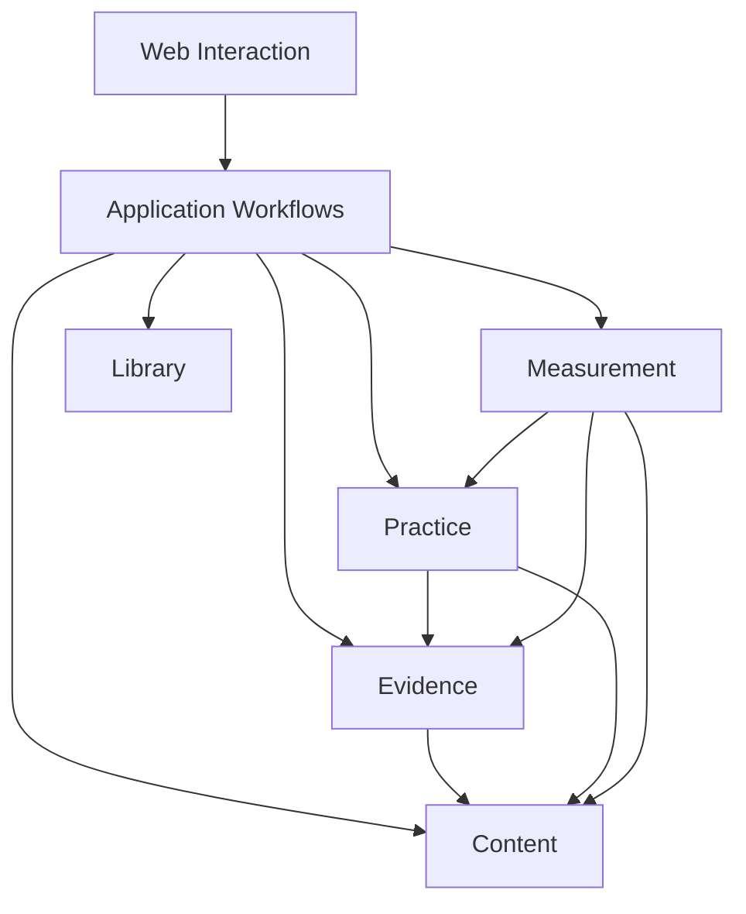

# Cohesive modules for the learning application

Status: finalized in [Design Baseline 1](design-baseline.md), 2026-10-16, responding to the user's requirement for high internal cohesion and low coupling. Baseline `0127a4f` on `codex/research/observability-campaign` named four modules but did not fully specify ownership, dependency direction or coordinated writes. This document makes those contracts explicit. It is a design continuation, not an implemented architecture or authorization to build the app. The [adversarial review](module-design-audit.md) examined proposal commit `07ea642`; the [response and contract revisions](module-design-review-response.md) give a disposition for all eighteen findings. Canonical snapshots are committed on `codex/research/observability-campaign` in the research checkout. Files in the primary prototype checkout are working copies, compared and copied at each design snapshot; they are not a second independently versioned baseline.

## Assessment and design objective

The existing design already separates content, actual observations, hypotheses, learning policy and measurement claims. It requires exact references, atomic corrections, preserved history and shared interpretation between practice and the dashboard. Those are useful foundations. A list of modules and separate Markdown documents does not yet establish modularity: the earlier outline does not say who owns each rule, who may write a record, or how modules participate in one correction.

The recent audits expose concrete design pressure: [shared-answer exposure](integrated-design-audit.md#g03-different-targets-can-expose-the-same-answer), [correction after subsequent checks](integrated-design-audit.md#g01-correcting-an-old-assessment-can-invalidate-the-basis-of-later-checks), and [uncertain hint time and effort membership](journey-invariant-audit.md). These are authored design counterexamples, not measured production incidents. They motivate single rule owners and explicit interfaces. They do not establish that a particular package layout is already effective.

Use one modular application. Modules communicate through in-process interfaces and share the authoritative store through a coordinated transaction. Physical deployment and language/framework remain separate choices. The four domain modules are **Content, Evidence, Practice and Measurement**. Three supporting modules are **Web Interaction, Application Workflows and Library**. These are logical responsibilities, not seven processes or seven databases.

Success means that a change has a clear owner, callers do not repeat its rules, and common changes stay local unless they deliberately change a published contract. Necessary coupling remains explicit: a rubric identifies what an answer is judged against, and correcting evidence can change a schedule. Hiding those relationships would weaken correctness.

## Modules and their interfaces

Each row describes one module's public interface, including its guarantees. The operation names are proposed behavioral families, not a language-specific SDK or a promise to introduce a class per operation. Portable records are public, versioned data with a single ordinary writer. Public read views expose only what a caller needs. Physical tables, repository code, algorithms and opaque engine-state interpretation remain implementation details; publishing a record schema does not make its database tables a caller interface.

| Module | Cohesive responsibility | Interface visible to callers | Complexity kept inside |
|---|---|---|---|
| **Content** | What can be learned and what a valid task asks | Inspect exact definitions; prepare an authoring proposal; accept/revise definitions and compatibility mappings | Source support, knowledge/target structure, rubrics, alternative answers, cue leakage, exercise families, teaching acceptance and semantic mapping. Preparing model-assisted material is explicitly an external operation; inspecting accepted definitions is read-only |
| **Evidence** | What the learner actually did and what that evidence supports | Save a bound response/observation; accept or correct an interpretation; resolve a named claim definition and qualify a history against its pinned identity | Scoped assessment, misreads, help/exposure, uncertain time, chronological ordering, distinct episodes, correction lineage, observation projections and explicitly uncertain hypotheses. Qualification returns reasons and exact evidence, not a universal mastery score |
| **Practice** | What learning work is needed and how to continue it | Change/resume enrollment or session; propose/reserve a next encounter; reconcile learning needs; read practice state at a declared context | Admission, unfinished work, concerns, repair limits, offer ownership, scheduling, actual-review eligibility, backlog priority, budgets, checkpoint awards and next actions. Scheduling and selection stay together initially because they share these invariants |
| **Measurement** | How to observe progress and account for effort honestly | Accept activity measurements; freeze/assign a tracking plan; calculate or save a report | Timer qualification, full effort, cost membership and overlap, fixed populations, endpoint assignment, metric definitions, missingness, uncertainty, shortlist presentation and reproducible reports. It consumes qualified evidence and practice state; it does not invent learning events |
| **Application Workflows** | Coordinate one user intention across modules | Handle typed commands and read typed page views; continue saved external operations | Command ordering, operation lifecycle, transaction participation, conflict handling, response assembly and fixed module wiring. Educational judgments and formulas stay with their domain owner |
| **Library** | Keep accepted history durable and portable | Consistent reads; one command transaction with receipt; archive integrity, staging and writer cutover | Atomic commit, idempotency, expected revisions, envelopes, sequence/watermarks, fingerprints, technical migrations, copy inventory and writer cutover. Application Workflows invokes each owner's export, stage/import, migration and validation functions through fixed wiring; Library never interprets domain tables |
| **Web Interaction** | Present state and collect user intentions and browser observations | Render application views; submit typed commands and raw collection observations | Navigation, drafts, accessible controls, focus, pending/conflict states and browser observation capture. It does not decide whether an answer is independent or calculate the authoritative cost total |

Keep interfaces task-oriented. Avoid exposing every stored field as a setter or requiring the browser to perform “save assessment, update concern, advance schedule” itself. Conversely, do not hide all behavior behind an untyped `execute(any JSON)` operation. Commands/results have explicit variants, exact bindings, conflict/error states and documented effects.

The important exchanged values are deliberately smaller than the owning module's records:

| Published value | Owner | What a caller receives |
|---|---|---|
| Definition view | Content | Exact target/exercise refs, required criteria/knowledge bindings, conditions, accepted compatibility and hold reasons; no permission to edit the definition |
| Qualified evidence view | Evidence | Source context, named claim/rule, per-requirement observations, eligibility/reasons, ordering limits and exact evidence refs; not a mutable learner state or scheduling instruction |
| Practice view / offer proposal | Practice | Scope, current need, due/offer eligibility, pending ownership, selected task and reason; engine internals stay private. A proposal is not a committed reservation |
| Budget summary | Measurement | Elapsed session time including breaks, separately measured effort, unknown/disputed duration and provenance for the requested session/context. Practice combines it with the learner's chosen budget; it does not receive or edit a report object |

A model result or cross-module proposal is not accepted merely because its shape is valid. Its owner still performs the checks required by the existing contracts. References and scalar time values can cross a seam without exporting the containing record's private implementation. Each record owner validates time-value shape using shared pure helpers. Practice owns session lifecycle facts, Evidence owns learning-time/ordering claims, and Measurement owns measured-duration, placement and effort claims. Attempt/session elapsed fields are removed from the unreleased portable contract; elapsed summaries are derived views, while measured durations live in activity spans. Failed or unavailable timing collection cannot block saving an answer: preserve unknown time under the existing contract.

## Dependency direction

Arrows mean “may depend on the public interface of.” They are not an event-flow diagram. This is a layered dependency design, not evidence of low coupling by itself. All server-side modules may use Library's transaction/read machinery; that common dependency is listed separately to keep the domain graph legible.

The complete allowed direct dependency set is:

| Module | May import/call |
|---|---|
| Web Interaction | Application Workflows' client-facing interface |
| Application Workflows | Content, Evidence, Practice, Measurement, Library |
| Content | Library |
| Evidence | Content, Library |
| Practice | Content, Evidence, Library |
| Measurement | Content, Evidence, Practice, Library |
| Library | No domain module; Application Workflows calls the owner validators against Library snapshots |

Calls to another domain module during a transaction are read/qualification calls through its public interface. Application Workflows initiates cross-module mutations in the required order; one domain module cannot secretly mutate another. Module interfaces do not expose internal helpers, table layout or SQL. Static architectural checks reject imports of private repositories and foreign table reads/writes; this is not runtime isolation from arbitrary code in the same process. Its owned repository uses the concrete Library transaction machinery. This is one chosen store implementation, not a speculative interchangeable-storage framework.

The shared vocabulary is small: identities/exact refs, time-evidence values, source context, algorithm identities and structured error/conflict values. It contains no mutable global learner object, table repository, metric formulas, scheduling policy or general-purpose “manager.” Owning modules publish the particular read views/results their callers need. The portable archive schema is a compatibility contract, not permission for callers to bypass these interfaces and inspect each other's tables.

### Prevent two likely dependency cycles

**Practice and Measurement.** Practice needs a session budget; Measurement needs practice scope and offer facts. Application Workflows obtains the measured budget summary and passes it as explicit input to Practice's next-action operation. Practice does not import Measurement. When Practice proposes an ordinary offer, Application Workflows asks Measurement to attach any prospectively eligible endpoint in the same transaction. Measurement retains a read-only dependency on Practice for its historical scope and offer views; moving every query into the coordinator would add plumbing without removing the semantic dependency. Measured budget facts can change how much work Practice chooses, including after a duration correction. Practice owns that decision under its explicit budget policy. Unknown duration is not zero or proof that a plan fits. Measurement cannot issue a practice mutation or request an extra exercise merely to improve its sample.

**Content and Evidence.** Content can need prior examples/exposure when authoring, while Evidence needs the bound rubric. Application Workflows obtains an evidence summary and puts its exact provenance into the authoring packet. Content does not import Evidence. Accepted-content inspection is read-only; any model-assisted semantic relevance review is an explicit prepared proposal, never a hidden model call during evidence qualification, report replay or a write transaction.

## One owner per rule and record

Each domain owner controls meaning, validation and ordinary writes for its records. The application owns only coordination records and writes domain acceptance dispositions supplied by typed owner results; it cannot decide those dispositions itself. Other modules use published read views, exact references and typed proposals. A cross-module transaction does not transfer ownership. Nested operational values follow their containing record, while shared value rules and referenced domain decisions retain their named semantic owner. A reference creates no right to edit the referenced record.

| Record kinds | Owner | Consequence |
|---|---|---|
| `source`, `knowledge`, `target`, `curriculum`, `exercise`, `teaching`, `mapping` | Content | Other modules cannot edit rubrics, source text or target meaning to make a result qualify |
| `attempt`, `study`, `assessment`, `review`, `projection`, `exposure`, `condition_checkpoint` | Evidence | Actual responses, help, timing and interpretations remain evidence. Practice supplies a validated owned-review binding before a `review` is accepted; a suggested rating on extra practice does not become a review |
| `enrollment`, `session`, `concern`, `schedule`, `practice_offer`, `selection` | Practice | Goal admission, checkpoints, ownership, repair and due work have one owner. Enrollment is learner state; Content owns the curriculum definition it references |
| `timing_run`, `activity_span`, `session_feedback`, `measurement_cohort`, `measurement_report` | Measurement | Timers and observations cannot grant review ownership, and a report cannot create an assessment or alter a schedule |
| `operation`, `transition` | Application Workflows | Records lifecycle and coordination only. `transition` links Practice-owned schedule effects; `operation` retains domain-supplied acceptance dispositions and output refs. The coordinator validates bindings/lifecycle but does not decide correctness or eligibility |

Library owns technical receipts, envelopes, schema metadata, active-writer authority and recovery/deletion bookkeeping. These are distinct from Measurement's timer grant and Practice's offer owner. Web Interaction owns only transient browser state and unacknowledged local work; acceptance through the application is what makes a domain record authoritative.

| Shared rule | Single semantic owner | How others use it |
|---|---|---|
| Source/rubric/target compatibility and exercise coverage | Content | Exact accepted definitions and mapping results; no caller reinterprets a title or similarity score as equivalence |
| Help, misread, time/order, scoped coverage and claim qualification | Evidence | Evidence publishes and validates named/versioned claim definitions; `qualify` receives their pinned identity and inputs and returns per-requirement results/reasons. Callers cannot substitute the local hint boolean for combined aid conditions |
| Required delay, review interval, diagnostic/repair budget and next action | Practice | Selects the named Evidence claim and declared delay parameters under its own saved policy, then acts on the qualified result; owns schedule effects and correction reconciliation |
| Fixed populations, endpoint assignment, cost membership, metrics and reporting precedence | Measurement | Uses qualified results for each named claim. It can request a supported variant with distinct pinned parameters and a clear label; Evidence owns the qualification definition/evaluator, while Measurement owns population, reporting partition and formula |
| Atomicity, retry identity, snapshot isolation and portable integrity | Library, coordinated by Application Workflows | One receipt for the complete command; domain validation and write contributions remain with their owners |

Evidence determines supported event order; Practice applies scheduling effects in that order. Measurement consumes the same qualified chronology rather than sorting answers by grading arrival. This partitions the existing [occurrence-order resolver](learning-lifecycle-contract.md#effective-event-order-and-recomputation) without introducing competing implementations. The same distinction applies to the [assistance rule](../learning-observability/data-contract.md#known-assistance-with-uncertain-time) and [cost membership](../learning-observability/data-contract.md#frozen-cost-membership-across-revisions): evidence interpretation belongs to Evidence; cost interpretation belongs to Measurement.

## Named qualification claims

Evidence owns the definition and validation of each supported qualification claim, including its name/version, declared parameter schema and meaning, assistance/coverage/order rules and result reasons. This is a fixed set of implementations in the app, not an executable user rule language. Callers select through Evidence's interface; they cannot supply a predicate, omit a required condition or silently use a latest version. Unknown definitions/parameters return unavailable/rejected as appropriate; historical reads never substitute today's rule.

Use the existing `Algorithm = {name, version, parameters}` identity. A delayed-independent-check claim pins the declared minimum-delay parameter; its inputs bind the exact target, answer, anchor and source context. Practice owns the policy choosing that delay and saves the complete resolved identity in `schedule.policy.parameters.qualification_claim` (null only when no qualification ran). Measurement saves the resolved identities in `measurement_cohort.claim_definitions` and the report definition. Evidence defines optional window/comparison conditions when the named claim needs them; Measurement still owns frozen populations, maturity, bucket precedence and metric arithmetic. Different parameter values are different claim identities and must be labelled, not treated as disagreement about one result.

For example, a Practice check and a dashboard evaluating the same independent-delay claim with the same 24-hour parameter, target, answer, anchor and S must obtain the same eligibility/reasons. A seven-day report claim may differ legitimately, but it has its own pinned parameters. Neither consumer can certify independence from the local hint flag alone. Adding a new qualification meaning changes Evidence and its named version; selecting existing parameters does not create a second implementation of that rule.

The record kind `condition_checkpoint` keeps its portable name. In prose/UI call it a **prospective condition boundary**; Practice's enrollment milestones are **achievement checkpoints**. Neither can stand in for the other, and no schema rename is needed just to distinguish their labels.

## Shared transaction, private responsibilities

Application Workflows starts one Library command transaction using the saved command ID, input digest and expected revisions. It passes a transaction-scoped context to the required owners. Owners validate and write only their own records; they cannot commit independently. Later participants see earlier writes in that same transaction, not an old external read. Library commits their complete receipt only after every required invariant succeeds. A technical failure or invalid contribution rolls back the whole command; a duplicate command returns its prior receipt. A domain `held` result is a successful contribution: retain the accepted correction and its evidence, prior due/state with an explicit hold, and other valid target effects. Unavailable algorithms and unresolved order must not discard a valid correction.

A module may use its private repository through this context; it cannot open a hidden second write transaction. Use build-time import rules plus a repository-access check for owned table access, including shared SQL helpers and import/migration paths. Reject an uninspectable computed table target rather than claiming the check passed. Seed a forbidden import and a foreign-table read/write to prove those checks fail. No runtime module-identity sandbox or row-level owner guard is promised for the one-process store. Technical envelope/reference checks stay in Library; Application Workflows invokes the fixed owner validation functions for semantic checks. This is direct composition, not a generic event bus or plugin registry.

**Accept a corrected assessment.** Application Workflows verifies the operation/command binding, asks Evidence to append the assessment and affected projections, then asks Practice to reconcile concerns, offers, schedules and enrollment checkpoints against the newly effective evidence. It records the transition and commits the whole receipt. Measurement's next query sees the committed result; it need not be called to rewrite old reports. A failure after the assessment write but before Practice finishes exposes neither half. No model request runs during this transaction.

**Offer an ordinary check with tracking.** Practice chooses and validates an offer using current evidence, content and the supplied budget. Evidence creates the bound initial draft. Practice reserves the applicable slots; Measurement assigns eligible frozen endpoints to that draft/offer before presentation. Application Workflows commits these records and the selection/receipt together, then Web Interaction may present the prompt. A conflict returns the existing resumable draft or the existing extra-practice path; it cannot reserve two owners or attach tracking after seeing an answer. Reference creation order follows the existing exact-ref rules, with the draft before the offer and the assignment after both.

**Save and assess an answer.** In one short command save the actual response/help, Practice's submitted-offer state and a credential-free pending assessment operation, whose exact inputs reference the newly submitted answer. Commit all three with one receipt before any model request. This rule covers submissions requesting model assessment; a later human correction uses the existing assessment-correction command. A crash before commit leaves the saved draft; after commit the pending operation is discoverable. Interrupted external requests retain their state and follow the explicit retry contract; a remote call is not claimed to execute exactly once. On completion, validate and accept its result through the correction/acceptance workflow above. Timeout leaves saved evidence and a pending/failed operation; it does not hold a database transaction, create an error grade or let a stale response attach to a changed binding.

**Change a curriculum or exposure interpretation.** Content validates the proposed definition/mapping, or Evidence validates the new exposure interpretation. Application Workflows coordinates affected Evidence/Practice reconciliation and enrollment activation in the same accepted transition. Measurement keeps its frozen outcome set and cost-membership rule. Any model-assisted proposal required by the change is prepared before the acceptance transaction; unavailable evidence yields the existing scoped hold, not a partial activation.

**Calculate a historical report.** Measurement reads Content definitions, qualified Evidence and Practice's historical state through public read interfaces, using one consistent source prefix S, evaluation time T and saved rule identities. Practice's historical view must respect that context, not return today's concern state. Reads create no domain events and invoke no models. Saving the result is a separate command that preserves the previously captured source prefix; it never silently advances S to the save time. Accepting an effort-attribution correction changes Measurement-owned evidence and new queries, while earlier reports remain immutable.

**Restore or upgrade.** Application Workflows calls fixed owner export/staging/import/migration functions and validators. Owners access their own physical records; Library supplies the shared snapshot, transaction, integrity and cutover machinery. Validation is read-only against the staged logical snapshot, including cross-record checks. Physical migration contributions share one transaction and cannot commit per module. Every owner preserves its logical IDs, exact refs, raw evidence, policy versions and saved states. A technical migration may change physical layout without becoming new teaching or a new review. Old algorithm unavailability follows the existing replay-unavailable contract; it does not authorize a fresh model call.

## Interface conditions and degradation

- Every read/result carries the declared source context and relevant definition versions. A caller cannot merge evidence from one S with current state from another and call it a consistent report. Transaction-internal calls share that transaction's view; published results are labelled with the completed source context.
- Mutation interfaces name expected revisions and expose conflict, pending external work, rejected proposal and unavailable qualification distinctly. Raw answer preservation follows the existing draft/submission contract even when later grading or policy work cannot proceed.
- Content and Evidence own their semantic model packets and response validation. Application Workflows owns external-operation lifecycle, authorized invocation and one selected provider transport adapter shared by both purposes. Content/Evidence own packets and semantic response validation, not separate provider transports. The provider adapter and a controlled timeout/malformed-response test adapter are justified; a general provider marketplace is not a prerequisite. Model identity remains provenance inside accepted records.
- The FSRS adapter is private to Practice. The browser, Evidence and Measurement cannot depend on its state layout or call it directly. Actual rating facts remain Evidence-owned; engine state, policy activation and due effects remain Practice-owned.
- Storage, clock and browser collection tests use the real selected persistence path and controlled inputs where relevant. A fake-green repository cannot establish multi-owner atomicity. The one-store design does not require an additional storage adapter just to satisfy an interface pattern.
- Report/replay/inspection interfaces do not perform remote requests. Long authoring/assessment calls run outside write transactions. Initial queries can traverse the actual selected history; measure their cost when implemented. Do not claim a latency target, add caches or distribute writes without a measured requirement.

## Changes that should stay local

| Change | Expected owner and deliberate effects | Unnecessary propagation to prevent |
|---|---|---|
| Fix hint-time interpretation | Evidence and the shared time-value contract if its shape changes; Practice/Measurement consume updated qualification | Separate help logic in the browser, scheduler and chart |
| Change cost-membership policy | Measurement with a new saved definition for new reports | Edits to Content, assessment semantics or the FSRS adapter |
| Change next-action priority or capability intervals | Practice, with explicit policy activation/provenance where required | Editing raw assessments or making Measurement choose exercises |
| Add a supported subject using existing fact/relation/procedure demands | Content material/protocols and semantic qualification examples | Subject-specific branches in scheduling, persistence or the dashboard |
| Change model provider | Application Workflows' provider adapter/configuration and operation provenance; semantic protocols change only if the accepted grading/authoring contract deliberately changes | Changes to retained record identity or unrelated practice/measurement formulas |
| Change dashboard rendering | Web Interaction and its page-view assembly where needed | Reimplementing authoritative eligibility or costs in chart code |
| Change physical storage layout | Affected owners' private repositories/migrations, called by the application under Library's transaction/integrity rules | Changes to domain meaning or published caller interfaces when their behavior is unchanged |

These are hypotheses about locality to verify during implementation. A changed public contract can legitimately affect multiple modules; preserve/version its behavior deliberately rather than claiming zero coupling. A genuinely new exercise modality may need changes beyond Content if it introduces a new kind of observation or collection requirement.

## Verification and build placement

The [first-build plan](first-build-plan.md#build-order-and-exit-checks) remains a sequence of end-to-end slices. Each slice builds the smallest needed path through these modules; do not build an empty framework or all modules' future features first. Use four domain packages plus the application/store organization and ordinary web UI when those responsibilities are exercised. The seven names are vocabulary, not a requirement for seven wrappers, services or separately packaged artifacts. Keep interface/export rules and the single command transaction from the first persisted encounter; do not add an empty package solely to satisfy the diagram. Make module internals private in the selected language, and check forbidden imports/record writes when the implementation exists. Exact repository paths and harness commands belong to that implementation prefill, not invented files in this design.

| Case | Observable obligation at the public interfaces |
|---|---|
| M01 Single-owner coverage | Every current domain kind has one ordinary writer. Deliberately introduced forbidden imports and foreign reads/writes make the architectural check fail; review generated/shared access paths rather than assuming a text search is complete |
| M02 Acyclic imports | The declared allowed-import graph is acyclic; Practice cannot import Measurement and Content cannot import Evidence |
| M03 Atomic correction | Exercise real application commands/store: failure between Evidence and Practice writes rolls back the whole correction. A valid held outcome commits it with a held schedule. Crash before/after submission commit and before/after assessment acceptance; resume the saved operation/receipt without orphaning the answer or applying an assessment twice |
| M04 Shared qualification | Known hint with unknown time and known external aid produce consistent per-target qualification for Practice and Measurement under the same pinned claim identity, parameters, inputs and source; unknown claims/parameters are refused. Deliberately different delay claims keep distinct identities and labels; unaffected criteria are preserved |
| M05 Prospective assignment | Two tabs read the same pre-offer revisions, then send different command IDs. The second hits the real stale/conflict path and resumes the existing draft, or explicitly starts extra work with mixed per-target roles. Preserve its answer and prospective bindings; no second owner, post-answer assignment or promotion of a released slot |
| M06 Historical context | Live and saved-report queries use the same S/T/definitions, including corrected attribution, late grading and unavailable old algorithms; a read creates no learning record |
| M07 Budget without reverse import | Measurement supplies known/unknown effort to the application; Practice applies its saved budget policy. A corrected cost may change selection; unknown time is not a saving. Measurement has no practice mutation or extra-sampling instruction |
| M08 External failure | Provider timeout/malformed/stale result leaves the saved answer intact, no false error or open database transaction, and a resumable operation |
| M09 Version continuity | Export/restore and a real future physical migration preserve all module-owned records, immutable reports, due states and unfinished work without model calls |
| M10 Locality experiment | Exercise the concrete changes above; explain every cross-module edit by a changed public contract or invariant. A growing pattern of unrelated edits is evidence to revise the module split |

Current verification can establish document links, record ownership coverage, the declared dependency DAG and consistency of these workflow traces. Actual cohesion, enforced encapsulation, performance and failure behavior require the built system and the named interface/integration checks. No numeric modularity score or proven maintainability gain is claimed.
